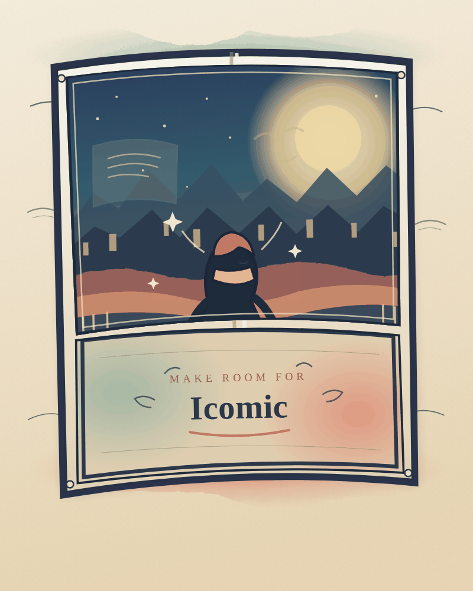

<p align="center">
  
</p>
<p align="center">
  
</p>
<p align="center"><a href="https://icomic.vercel.app">Live demo: https://icomic.vercel.app</a></p>
<p align="center">
  <a href="docs/BRAND.md">Brand concepts and usage</a>
</p>

<h1 align="center">Icomic</h1>

Turn a written story into a comic, one reviewable stage at a time.

Icomic is an AI-powered comic creator with an approval-gated workflow. Writers can shape characters, plan chapters, review page compositions and line art, colour pages, then export a comic. Deterministic fake adapters keep the app usable and testable without credentials or network access.

## The eight stages

1. Script
2. Characters and reference images
3. Chapter outline
4. Panel text and page layout
5. Rough page sketches
6. Final line art
7. Colouring
8. Comic assembly and PDF export

Image stages wait for explicit approval, and users can review generated work before moving forward.

## Run locally

Run the full hermetic test suite with fake adapters:

```sh
make test
```

Run the frontend in its deterministic mock mode without a backend:

```sh
npm --prefix frontend ci
PUBLIC_USE_MOCK_API=true npm --prefix frontend run dev
```

Run the end-to-end comic flow against the fake adapters. This uses the local Compose services, including PostgreSQL:

```sh
make e2e-comic
```

To run the whole stack on your machine, see [docs/PERSONAL_RUN.md](docs/PERSONAL_RUN.md): what it needs, the spend cap, what survives a restart and how to back up.

For CI checks and toolchain details, see [docs/CI.md](docs/CI.md).

## Architecture and project docs

- [Running it on your machine](docs/PERSONAL_RUN.md)
- [Architecture](docs/ARCHITECTURE.md)
- [Product specification](docs/SPEC.md)
- [Meta adapter configuration and deferred live swap](docs/META_SWAP.md)
- [Multipage comic flow](docs/MULTIPAGE.md)
- [Continuous integration guide](docs/CI.md)
- [Frontend setup and configuration](frontend/README.md)

## AI and age advisory

Comics created with Icomic may contain AI-generated text and images; generated content must be disclosed in the editor and exported comic. An 18+ advisory is planned, but no age gate is enforced in the current build and the final age threshold remains to be confirmed.

## Meta generation

The live Meta adapter swap is deferred; development and automated tests use fake adapters. A live swap will follow the approval and verification steps in [docs/META_SWAP.md](docs/META_SWAP.md) after credentials and credits are explicitly provisioned.

**Status:** In development.<br>
**Licence:** No licence file is currently present.
